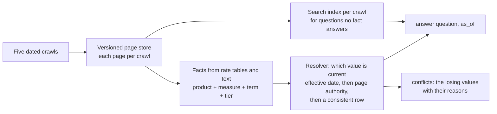
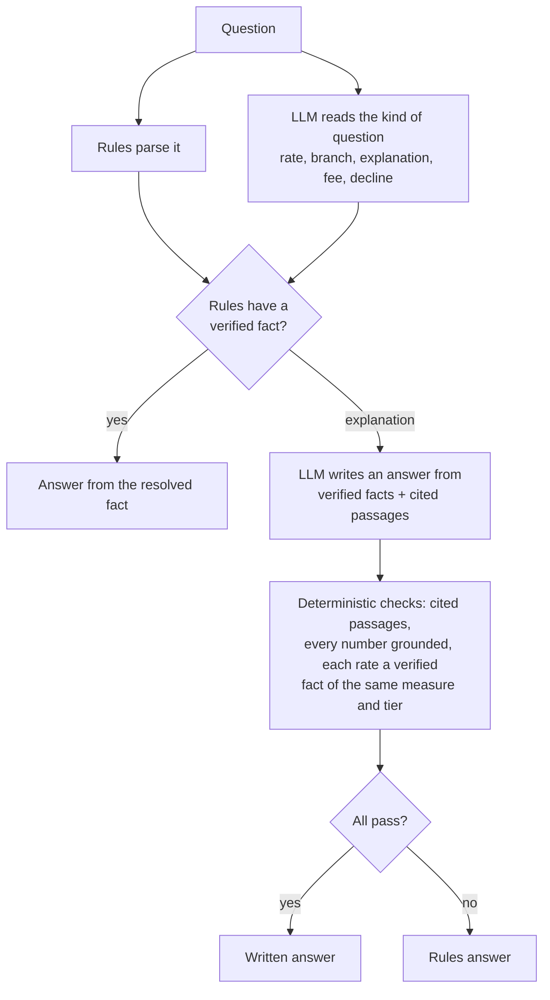

# Temporal knowledge base

Answers questions about a credit union's website from **five dated crawls of it**: what a rate, fee, branch or
policy is, what it **was** on a given day, and where the site **contradicts itself** (a calculator page with an old
rate, a press release with an old branch count). Every answer names its source page and crawl.

Python standard library only - no packages, no database. Two modes:

| Mode | How | Measured with the scorer provided |
|---|---|---|
| **Rules only** (default) | nothing to set; never calls the network | public practice set: accuracy 0.969, final score 0.949, p95 0.04 s |
| **Rules + LLM** | `export ANTHROPIC_API_KEY=...` (Claude Haiku) | +0.05 to +0.34 accuracy on unseen blind sets; public set 0.92-0.95; p95 2-3 s |

No key is stored in this repository. Without one, the rules-only mode runs.

## A worked example

| Question | `as_of` | Answer (abridged) |
|---|---|---|
| What is the APY on the 10-month certificate special? | today | 3.90% APY (effective 09/01/2026) - crawl of 2026-09-28 |
| the same | 2026-05-12 | 3.80% APY (effective 03/03/2026) - crawl of 2026-05-12 |
| What's the APR on a 60-month auto loan for a 2025 car? | today | 5.39% APR (effective 08/31/2026). Not used: 5.34% on the loan calculator and a promo page, effective 2026-01-01 (stale copies) |
| How many branches does Dupaco have? | today | 22, per the newest press release (May 5, 2026). Not used: 23 in three older releases |

`conflicts()` lists 16 such contradictions, grouped by topic ("60-month auto loan APR"), each with the winning
value, the reason, and every page and crawl involved.

## How it works

**What "current" means.** A fact is a key, not a string: a 60-month auto loan APR for model years 2024-27 is a
different fact from the 2021-23 one, and an APY is not a dividend rate. For one key, the latest effective date wins;
then page authority (rate sheet over product page over promo or calculator); then an internally consistent row over
a typo. Text facts (a branch count) go to the newest publication. For a past date, the crawl of that day is used,
corrected by later crawls whose tables were already effective that day.

### The optional LLM: it reads and words, it never decides values

The LLM never chooses which value is true, cannot override a fact the rules found, and cannot quote a rate from
prose (it may be stale). If the API is slow, fails or replies badly, that question gets the rules answer; repeated
failures switch the LLM off for the run. Each question has a time budget, and a repeated question gets the same
answer.

## How it was evaluated

Beyond the 40-question practice set, the system was tested on **blind sets written by outside models that had not
seen the code**. Each set's answer key was checked against the crawls, and the set was frozen by SHA-256 in a commit
**before its one and only first run**; those first runs are kept unchanged. Fixes came after, as general rules with a
test that fails without them, and every older answer was re-compared word for word after each change.

| Blind set | First run, rules only | First run, rules + LLM | After its fixes (rules / LLM) |
|---|---|---|---|
| A (40) | 0.50 | - | 0.92 / 0.97 |
| B (40, rare topics) | 0.40 | - | 0.43 / 0.75 |
| B1 (40, multi-part) | 0.42 | 0.46 | 0.51 / 0.70 |
| C (40, practice-set style) | 0.59 | 0.71 | 0.84 / 0.98 |
| D (30, written after all earlier fixes) | **0.67** | **0.72** | 0.71 / 0.84 |

The first-run columns are the honest estimate for questions nobody tuned for; the last column measures the fixes.
Set D, written after C's fixes, scored higher on its first run than C did - the fixes carried over to new questions.

## Limitations

- Rules-only text answers are chosen by word overlap: where the site has no answer, the chosen text can be unrelated.
- Questions asking several things at once often get only the first part from the rules.
- With the LLM, an answer can differ slightly between runs (the model takes no temperature setting).

## More

- `submission/NOTES.md` - setup, all results, guardrails, limitations
- `docs/RULES.md`, `docs/PROJECT_STATE.md`, `docs/EDGE_CASES.md` - every rule and decision, with its evidence
- Tests: `pip install pytest && pytest -q` (the two that need the scoring harness are skipped without it)

The website crawls and evaluation datasets were provided for the event and are not included.
